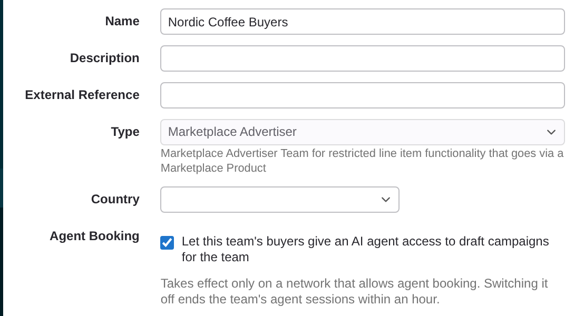
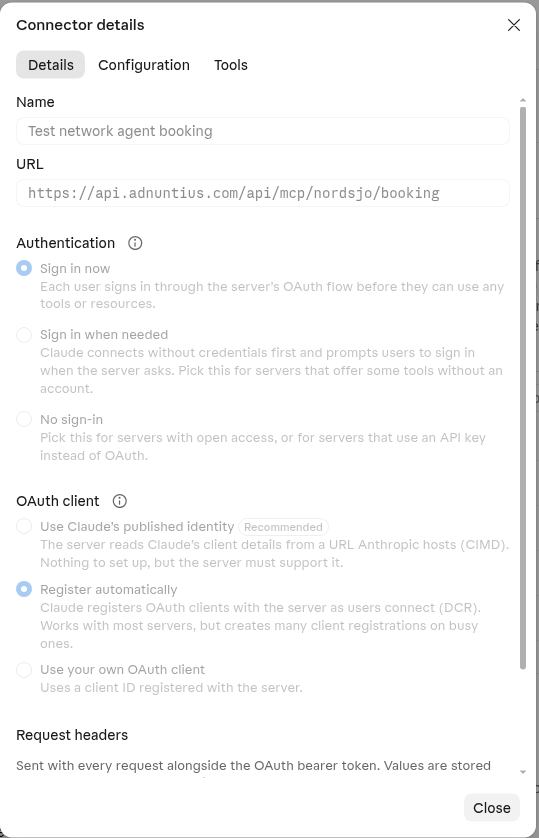
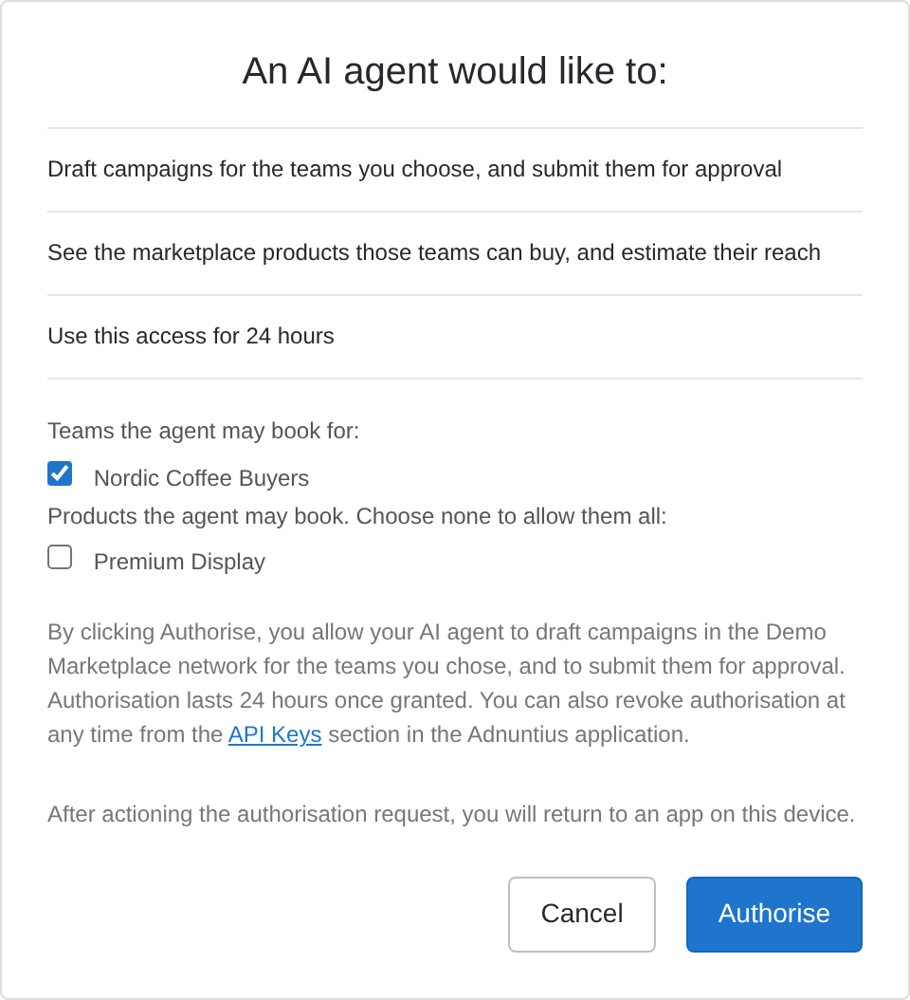
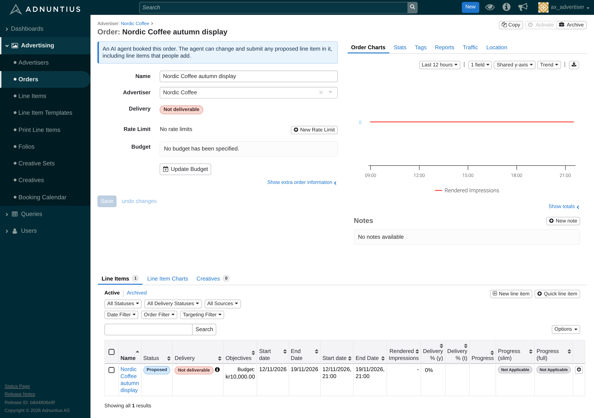
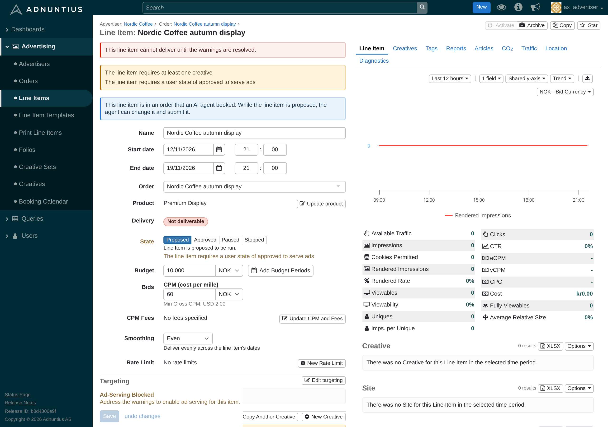
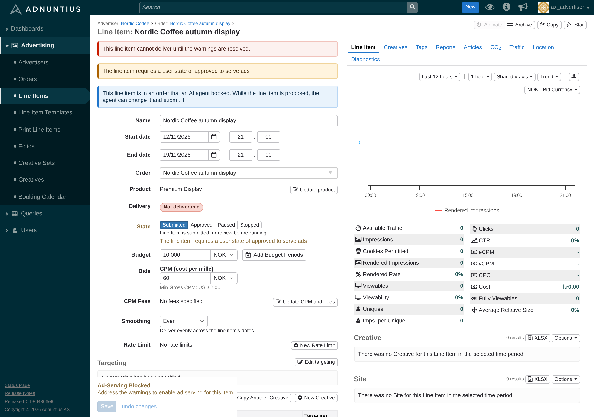
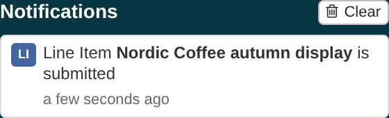

# Book a campaign with an AI agent

An AI agent can draft campaigns for your buyer team. The agent finds a product, estimates the reach, and creates an order with a line item in Adnuntius. 
It can also submit the line item for review.
It works with the agents that the [MCP Server](README.md) supports.

## Requirements

* **Adnuntius has switched on agent booking for your network.** Ask Adnuntius support for the "agent booking address" for your network.
* **A network admin has switched on agent booking for your buyer team.** In Adnuntius, open the team under `Users -> Teams`, tick `Agent Booking` and save.

<figure><figcaption></figcaption></figure>

* **You buy for that team.** Your user must have a marketplace buyer role on the team. A network admin cannot have a buyer role on the same network,
  so a network admin needs a separate buyer login.
* **You sign in with two-factor authentication or a passkey.**
* **The advertiser exists on the team.** The agent cannot create an advertiser entity, it books for one or more of your team's existing advertisers.

### 1. Add the booking connector

The address to use here is the one you receive from Adnuntius support when you request this feature, it looks like
```
https://api.adnuntius.com/api/mcp/<network id>/booking
```

Add this address to your agent as a new MCP server, the same way as for the [MCP Server](README.md) but with the
booking address. Keep the MCP server you already have: the booking connector is separate from it.

**In Claude:** when Claude asks how to sign in, choose `Sign in now`, and for the OAuth client choose `Register automatically`. 

<figure><figcaption></figcaption></figure>

### 2. Connect and choose the teams

Start the sign-in from your agent, as for the MCP server. Adnuntius opens in your browser; sign in if it asks you to.
Choose the teams that the agent can book for. You can also limit
the agent to some products. Then click `Authorise`.

<figure><figcaption></figcaption></figure>

The access lasts 24 hours. After that, sign in again from your agent.

### 3. Ask the agent for a campaign

Tell the agent what you want to book, for example:

> Book a two-week display campaign for Nordic Coffee on the Premium Display product, starting next Monday, with a
> budget of 10,000 NOK. Estimate the reach first.

The agent lists the products that your team can buy, estimates the reach, and creates the order and the line item.
It gives you a link to the line item in Adnuntius.

If you also allow [creative uploads through the customer connector](upload-creatives-with-an-ai-agent.md),
you can ask for the whole workflow in the same instruction:

> Add creatives from the files I provide and submit the campaign for review once validation passes.

### 4. Check the campaign and add the creative

Open the order in Adnuntius. The order shows that an AI agent booked it.

<figure><figcaption></figcaption></figure>

The line item is `Proposed`. While it is proposed, either you or the agent can change it. Add creatives in Adnuntius,
or let your agent [upload creatives through the customer connector](upload-creatives-with-an-ai-agent.md) with separate upload consent.

<figure><figcaption></figcaption></figure>

### 5. Submit and approve the line item

The agent can submit the campaign when the creatives are in place and no blocking validation warnings remain. If your original
request did not include submission, ask it to submit now. After submission, the booking connector cannot change the campaign.

<figure><figcaption></figcaption></figure>

The buyers on your team get a notification. They can click on the `i` icon at the top of Adnuntius to see it and set 
the state to `Approved`.

<figure><figcaption></figcaption></figure>

The line item serves from its start date once it is approved.

## Troubleshooting

* **The consent page asks only for query access and does not list teams.** The agent connected to the MCP server address, not the booking
  address. Add the booking address as its own MCP server.
* **The agent says that the connector has a sign-in configuration problem.** The connector was saved with `No sign-in`.
  Remove it and add it again with `Sign in now`.
* **The consent page says "This network does not allow agent booking".** Ask Adnuntius support to switch it on.
* **The consent page says "The agent cannot book for team ...".** Agent booking is off for that team, or the login you
  signed in with has no buyer role on it. A network admin login never has one, so sign in with a buyer login.
* **The agent cannot submit the line item.** The line item has no creative yet, or it has another validation error.
  Open it in Adnuntius to see what is missing.
* **The agent stops working after a day.** The access has expired. Sign in again from your agent.
