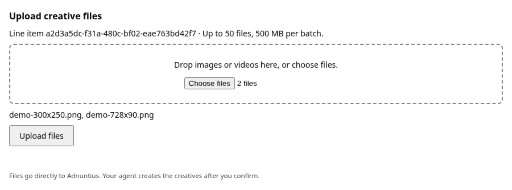
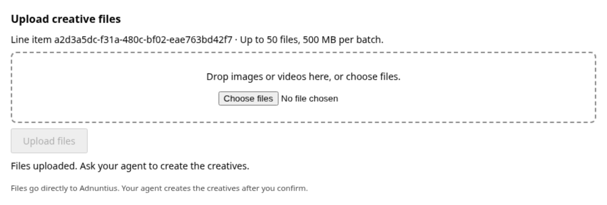

# Upload creatives with an AI agent

Your agent can upload images and videos and create one creative per file on an existing line item. You choose the line item, confirm any layout choices, and ask the agent to create the creatives.

## Connect with upload permission

Use the ordinary [MCP Server](README.md) connector. When you authorise it, select your network and **Allow creative uploads**. You need permission to manage advertising on the line item's team. Sign in with two-factor authentication or a passkey.

Upload permission lasts 24 hours. You can end it sooner in **API Keys**. To add upload permission to an existing read-only connection, reconnect and select the upload option.

New creatives can serve immediately on a running line item. For a demo, choose a line item that starts in the future.

## Choose the line item and upload files

Ask your agent:

> Find my demo line item and open the creative upload view.

Confirm the line item before you upload. In a client that supports MCP Apps, choose or drop images and videos into the **Upload creative files** view.

<figure><figcaption>
Choose the files to upload.
</figcaption></figure>

Press **Upload files**. The files go directly from your device to Adnuntius. The view confirms the upload and shares their asset IDs with the agent.

<figure><figcaption>
The files are ready for the agent to create creatives.
</figcaption></figure>

You can upload up to 50 files and 500 MB per batch. Finish creating the creatives for one batch before uploading the next. Each upload address expires within ten minutes. If it expires, ask your agent for a new address. ZIP bundles are not supported yet.

A terminal agent can upload files from disk to the address returned by `prepare_creative_upload`, using a multipart POST with the field `files`. It then receives the asset IDs in the response. An attachment in the chat alone does not upload a file to Adnuntius.

If the view cannot share the IDs with the agent, it shows them for you to copy into the conversation.

## Create and check the creatives

Here is an example of what you might ask your agent:

> Use these uploaded files to create creatives on the demo line item. Use https://example.com/demo as the click destination. Ask me if several layouts fit.

The agent will use our `create_creatives_from_assets` tool to report a result for each file:

* **created**: the response names the new creative and its layout.
* **choose_layout**: choose a layout before the agent retries this file.
* **no_layout**: none of the line item's layouts takes the file.
* **refused**: the response explains why the server could not create the creative.

The agent will retry only files that did not create a creative. To use a successfully attached file again, upload another copy.

The agent will give a link to the line item in Adnuntius for you to check the creative previews, names, dimensions and click destinations. Layout text and choice fields start with the layout's defaults. Check any validation warnings before you start the campaign.
